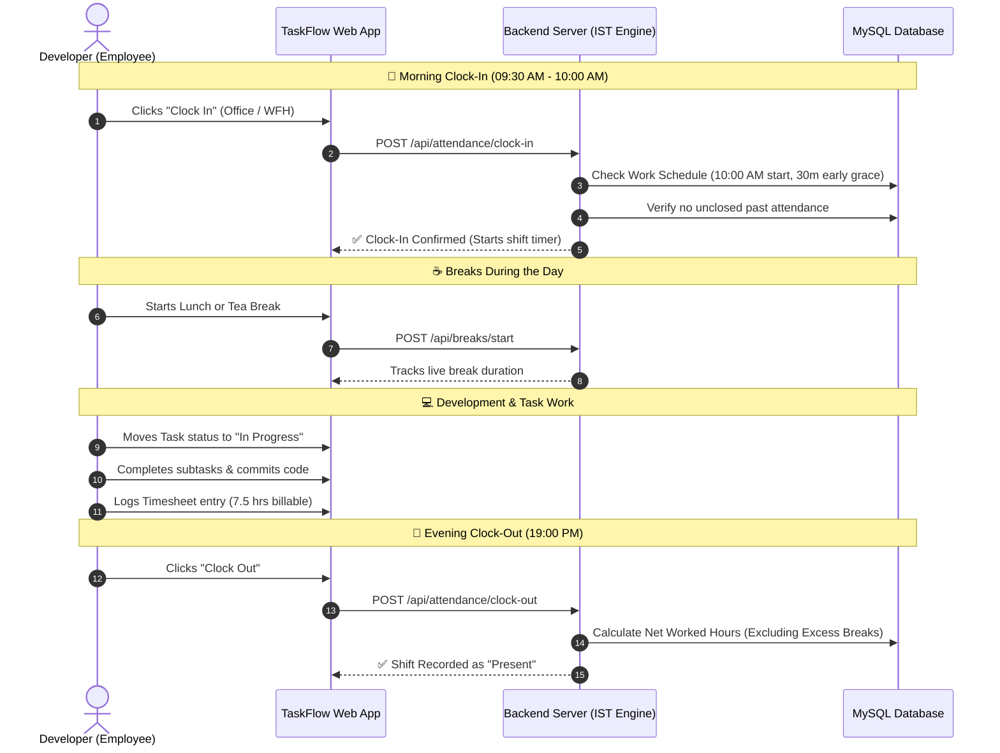

# 📘 TaskFlow ERP — Complete Modules & Workflow Guide (English)

TaskFlow is an enterprise operations and workforce management portal designed for modern software companies. It coordinates employees, projects, attendance, payroll, and financials in one integrated platform.

---

## 🏗️ 1. System Architecture

```mermaid
graph TD
    Client["Client Browser (Web & PWA)"]
    
    subgraph Frontend["Frontend Layer (React 19 + Vite)"]
        UI["Glassmorphic UI / Tailwind & Vanilla CSS"]
        State["State Management & Socket Listeners"]
        Router["Role-Based Route Guards"]
    end

    subgraph Backend["Backend Layer (Node.js & Express)"]
        Auth["JWT Auth & Dynamic RBAC Engine"]
        Socket["Socket.io Real-Time Engine"]
        Services["Domain Controllers & Business Logic"]
        TZ["IST (Asia/Kolkata) Timezone Engine"]
    end

    subgraph Database["Data Layer (MySQL / phpMyAdmin)"]
        DB[(MySQL Database: taskflow_db)]
        Tables["24 Relational Tables\n(Projects, Tasks, Attendance, Staff, Leaves, Expenses)"]
    end

    Client --> UI
    UI --> Router
    Router --> State
    State <-->|REST API (Axios)| Services
    State <-->|Websocket Events| Socket
    Services --> Auth
    Services --> TZ
    Services --> DB
    DB --- Tables
```

---

## 👥 2. Roles & Responsibility Hierarchy

| Role | Primary Responsibilities | Scope of Access |
| :--- | :--- | :--- |
| **Super Admin / Owner** | Full company setup, work schedules, salary structures, financial approvals. | System-wide (100% read/write access). |
| **Project Manager** | Creates projects, delegates tasks, approves timesheets, reviews bug reports. | Project & assigned team member scope. |
| **Developer / Staff** | Clocks in/out, takes breaks, logs timesheets, requests leaves & reimbursements. | Personal self-service scope. |
| **QA Engineer** | Creates test cases, executes test runs, logs bug tickets with repro steps. | Quality assurance & project scope. |

---

## 📑 3. All 18 Modules — Detailed Workflows

### 1. 🔐 Authentication & Role-Based Access Control (RBAC)
* **Purpose:** Ensures secure user verification and dynamic permission checks across all API routes and UI views.
* **Workflow:**
  1. Users sign in using their registered email and password.
  2. The server authenticates credentials against bcrypt hashes and issues a signed JWT token.
  3. UI route guards load only the permitted navigation links based on permissions (`staff_management`, `task_management`, `expense_management`, etc.).
  4. Super Admins can adjust permissions per role in real-time from the Role Management panel.

---

### 2. ⏰ Attendance & Shift Management
* **Purpose:** Governs daily work shifts, punch timing, late arrival penalties, and forgotten punch handling.
* **Workflow:**
  1. **Clock In:** Allowed starting at **09:30 AM** (up to 30 minutes before the scheduled 10:00 AM shift start). The employee chooses **Office** or **WFH**.
  2. **Grace Period & Late Penalties:**
     * Arriving between 10:00 AM and 10:30 AM falls within the 30-minute grace window.
     * Arriving after 10:30 AM registers a **Late Instance** (maximum 3 allowed per month).
     * Exceeding 3 late instances or arriving after 12:00 PM triggers an automatic **First Half Day** deduction.
  3. **Clock Out:** In the evening (19:00 PM onwards), employees clock out. The system logs total hours worked and marks status as `Present` or `Half Day`.
  4. **Auto-Clock Out & Missed Punch:** Employees who forget to clock out are auto-closed at 11:00 PM. Before clocking in the next morning, they must submit a **Second Half Leave** for the missed day.

---

### 3. ☕ Break Management
* **Purpose:** Monitors work intermissions (Lunch and Tea breaks) to maintain productivity compliance.
* **Workflow:**
  1. The employee clicks **Start Break** (Lunch Break: 40 mins, Tea Break: 20 mins).
  2. A live timer runs on the UI dashboard; simultaneous breaks are restricted.
  3. Upon returning, the employee clicks **End Break**.
  4. Any duration exceeding the configured limit is flagged as **Excess Break** on daily attendance reports.

---

### 4. 📁 Project Management
* **Purpose:** Manages client deliveries, internal products, and high-level milestones.
* **Workflow:**
  1. Managers or Admins create a project by entering Name, Description, and Status (`Active`, `On Hold`, `Completed`).
  2. **Assigning users is optional** — projects can be created without staff and assigned at any point.
  3. Projects serve as the parent entity for task assignments, timesheets, and client billable hours.

---

### 5. 📋 Task & Subtask Delegation
* **Purpose:** Breaks down project roadmaps into assignable work items for team members.
* **Workflow:**
  1. Tasks are created under specific projects with Priority (`Critical`, `High`, `Medium`, `Low`), Due Dates, and Estimated Hours.
  2. Complex tasks are broken down into granular **Subtasks**.
  3. Developers update progress dynamically: `Pending` ➡️ `In Progress` ➡️ `Complete`.

---

### 6. ⏱️ Timesheet Management
* **Purpose:** Records daily hours worked against projects for client billing and operational audits.
* **Workflow:**
  1. At day-end, employees record hours spent per project/task, tagging items as **Billable** or **Non-billable**.
  2. Project Managers review submitted entries and click **Approve** or **Reject** with feedback.
  3. Approved hours automatically aggregate into client billing summaries.

---

### 7. 🏖️ Leave Management
* **Purpose:** Facilitates time-off requests, balances, and multi-tier approval workflows.
* **Workflow:**
  1. Employees are allotted annual quotas: **Casual Leave (CL: 12)**, **Sick Leave (SL: 8)**, **Paid Leave (PL: 15)**, and **Comp-Off**.
  2. Requests can be submitted for **Full Day**, **First Half**, **Second Half**, or **Short Leave** (2 hours).
  3. Approving managers receive immediate alerts; once approved, balances are deducted automatically.

---

### 8. 💰 Expense Management & Reimbursements
* **Purpose:** Governs out-of-pocket business expenditures and employee reimbursement claims.
* **Workflow:**
  1. Employees file expense claims choosing a Category (Travel, Meals, Client Entertainment, Software).
  2. Receipts/invoices are uploaded, and expenses are validated against company policy caps.
  3. The claim transitions through a four-stage lifecycle: `Draft` ➡️ `Submitted (Pending)` ➡️ `Approved` ➡️ `Paid`.
  4. Accounts teams issue payments and mark records as settled.

---

### 9. 🧪 QA & Bug Tracking
* **Purpose:** Standardizes software test cycles, bug reporting, and defect triage.
* **Workflow:**
  1. QA Engineers formulate **Test Cases** (Preconditions, Steps, Expected Results) and record execution outcomes (`Pass` / `Fail`).
  2. Defects produce **Bug Reports** specifying severity (`Critical`, `Major`, `Minor`) and testing environment (`Staging`, `Production`).
  3. Developers fix the issue and reassign it to QA for regression testing and closure.

---

### 10. 🏢 Client Management & Invoicing
* **Purpose:** Centralizes client accounts and automates hourly/milestone invoicing.
* **Workflow:**
  1. Client profiles are created with company details, contacts, and hourly billing rates.
  2. Projects are linked to clients.
  3. Timesheet data is compiled into branded invoices ready for export or client dispatch.

---

### 11. 💵 Payroll & Salary Management
* **Purpose:** Calculates monthly compensations, deductions, and downloadable payslips.
* **Workflow:**
  1. Salary structures are configured per employee (Annual CTC, Monthly Basic, HRA, Allowances).
  2. The system computes statutory deductions: **PF**, **Professional Tax (PT)**, **TDS**, and unpaid leave days.
  3. At month-end, the system generates downloadable **Payslip PDFs** accessible in employee self-service.

---

### 12. 💻 Company Assets & Hardware Inventory
* **Purpose:** Tracks physical IT hardware and enterprise software seats.
* **Workflow:**
  1. Physical assets (MacBooks, Dell Laptops, Monitors) and software licenses are logged with unique Asset Tags and serial numbers.
  2. Assets are assigned to specific team members with physical condition notes.
  3. Return condition inspections ensure equipment integrity when employees transition roles.

---

### 13. 📢 Announcements & Notice Board
* **Purpose:** Broadcasts company news, events, and mandatory HR policies.
* **Workflow:**
  1. Admins publish announcements with priority tags (`High`, `Normal`) and can pin vital notices to the dashboard.
  2. For critical circulars, the **"Requires Acknowledgment"** flag requires employees to confirm they have read the post.

---

### 14. 🗓️ Company Holiday Calendar
* **Purpose:** Publishes the official calendar of festive and national holidays.
* **Workflow:**
  1. National and public holidays (Republic Day, Holi, Independence Day, Diwali, Christmas) are scheduled for the calendar year.
  2. The attendance engine recognizes these dates as official holidays and exempts employees from absent marks.

---

### 15. 💬 Team Chat & Messaging
* **Purpose:** Enables instant team communication without leaving the workspace.
* **Workflow:**
  1. Driven by a dedicated **Socket.io** WebSocket engine for sub-millisecond message delivery.
  2. Supports direct 1-on-1 private messaging and project group channels with image and document sharing.

---

### 16. 🎫 Internal IT Helpdesk / Tickets
* **Purpose:** Resolves workplace technical, infrastructure, and facility issues.
* **Workflow:**
  1. Employees open support tickets (e.g., "Secondary display faulty", "VPN credentials reset").
  2. IT coordinators claim the ticket, interact with the submitter, and update the status to **Resolved**.

---

### 17. 🏠 Work From Home (WFH) Requests
* **Purpose:** Provides a structured approval mechanism for remote work days.
* **Workflow:**
  1. Employees submit desired remote work dates and justifications.
  2. Managers review the request.
  3. Once approved, the attendance punch widget accepts remote clock-ins on those specific dates.

---

### 18. 📈 Performance Ratings & Reviews
* **Purpose:** Facilitates periodic appraisals and constructive employee feedback.
* **Workflow:**
  1. Leads provide structured 1–5 star ratings across key competencies (Code Quality, Communication, Delivery).
  2. Historical performance reviews remain accessible for salary appraisals, promotions, and annual reviews.

---

## 🔄 4. A Day in the Life — Employee Operational Flow


